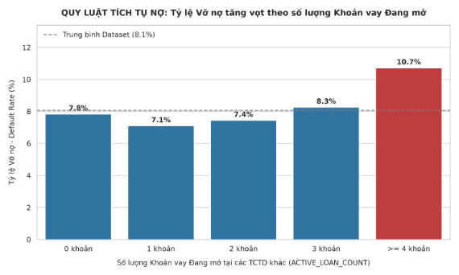
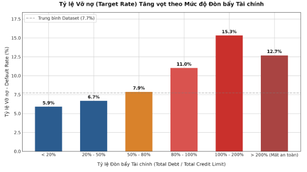
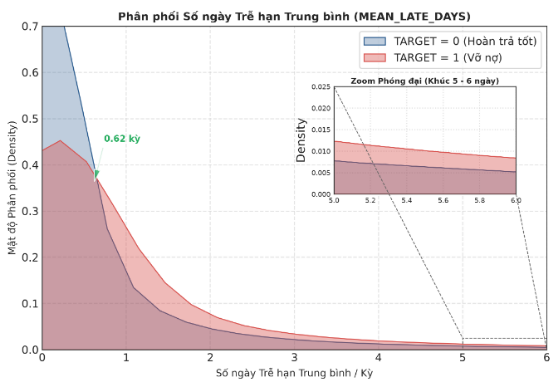
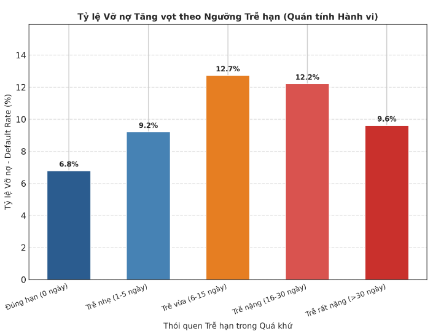

# DỰ ÁN CẢI TIẾN THÔNG MINH VÀ QUẢN TRỊ RỦI RO CHO FINTECH

> **Học viên:** Nguyễn Ngọc Minh Khôi  
> **Mã học viên:** `FX02169`  
> **Vai trò:** Nhà tư vấn chiến lược doanh nghiệp  
> **Tập dữ liệu áp dụng:** [Home Credit Default Risk (Kaggle Dataset)](https://www.kaggle.com/competitions/home-credit-default-risk/overview)

---

## PHẦN 1: BỐI CẢNH

### 1.1. Bối cảnh Doanh nghiệp & Bài toán Kinh doanh
**Home Credit** là tổ chức tài chính tiêu dùng hoạt động trong môi trường thị trường biến động mạnh, với nhóm khách hàng chủ lực thuộc phân khúc **Underbanked / Unbanked** (những đối tượng ít hoặc không có lịch sử tín dụng truyền thống).

Tệp dữ liệu được nghiên cứu là dataset mã nguồn mở **“Home Credit Default Risk”** — tập dữ liệu ghi nhận hoạt động cho vay tiêu dùng và lịch sử tín dụng chi tiết của Tập đoàn Home Credit, được thu thập giai đoạn 2017–2018 và công khai vào năm 2018. Dù đã ra đời hơn nửa thập kỷ, tập dữ liệu này vẫn mang lại giá trị cốt lõi đối với các startup Fintech trong công tác nghiên cứu mô hình rủi ro tín dụng và bóc tách quy luật tâm lý - hành vi người dùng.

### 1.2. Các câu hỏi trọng tâm bài phân tích giải quyết
* **Data (Khai phá dữ liệu):** Việc khai phá tập dữ liệu *Home Credit Default Risk* phải chỉ ra được những góc khuất, rủi ro ngầm ẩn đằng sau hành vi tín dụng của các nhóm khách hàng.
* **Giải pháp & Chiến lược:** Từ kết quả khai phá dữ liệu ban đầu, xác định giải pháp công nghệ và nghiệp vụ nhằm tháo gỡ các điểm nghẽn vận hành. Đồng thời, xây dựng chiến lược tiếp tục lưu trữ và phân tích dữ liệu lịch sử hành vi khách hàng để phát hiện các quy luật mới, đảm bảo tuân thủ nghiêm ngặt hành lang pháp lý.

---

## PHẦN 2: TỔNG QUAN & PHƯƠNG PHÁP LUẬN

### Phương pháp luận: Chủ nghĩa Duy vật Biện chứng
Áp dụng thế giới quan và phương pháp luận của **Chủ nghĩa duy vật biện chứng** (đặc biệt là **Quy luật Lượng - Chất**), rủi ro tín dụng không được xem xét như một thuộc tính tĩnh tại, cố định của cá nhân, mà là **kết quả của sự tích lũy dần dần về lượng** (số lượng khoản vay mở, tỷ lệ đòn bẩy, số ngày trễ hạn) **dẫn đến sự biến đổi nhảy vọt về chất** (trạng thái vỡ nợ / mất khả năng thanh toán).

Trên cơ sở đó, báo cáo tập trung làm rõ các mối liên hệ nhân - quả mang tính quy luật giữa hành vi tài chính của người dùng và tỷ lệ nợ xấu của doanh nghiệp.

### Tóm tắt Giải pháp Chiến lược
1. **Dữ liệu (Data):** Nhận diện các điểm nghẽn mang tính quy luật: sự tích tụ quá mức về "lượng" đòn bẩy tài chính (*vòng xoáy nợ chồng nợ*), tần suất tra cứu tín dụng dồn dập (*hành vi khát vốn*), và quán tính thanh toán trễ hạn tích lũy dẫn tới bước ngoặt vỡ nợ. Từ đó đánh giá chính xác tác động lên tỷ lệ nợ xấu (NPL), nguy cơ thất thoát vốn và chi phí thẩm định.
2. **Công nghệ (Tech):** Xây dựng hệ thống **AI Agent** & **Scoring Engine** tự động hóa quy trình xử lý hồ sơ và chấm điểm rủi ro theo thời gian thực (Real-time); tích hợp tính năng trích xuất, tổng hợp hồ sơ đối với các ca rủi ro cao để hỗ trợ nhân viên tín dụng ra quyết định.
3. **Nghiệp vụ & Rủi ro (Governance & Risk):** Thiết lập hệ thống rào chắn an toàn (Guardrails) chống thiên kiến dữ liệu (*Algorithmic Bias*), ngăn chặn ảo giác AI (*AI Hallucination*) và tuân thủ chặt chẽ quy định pháp luật Việt Nam về hoạt động tín dụng và bảo vệ dữ liệu cá nhân.

---

## PHẦN 3: PHÂN TÍCH CHI TIẾT

### 3.1. Bằng chứng Dữ liệu (Dựa trên File Notebook `Rule1.ipynb` & Dataset)
Dữ liệu được trích xuất, làm sạch và kết nối từ 3 bảng cốt lõi: `application_train.csv`, `bureau.csv`, và `installments_payments.csv`.

#### Quy luật 1: Vòng xoáy Nợ chồng Nợ (Multi-Lending & Debt Spiral)
* **Bản chất:** Sự tích lũy về số lượng khoản vay đang mở và mức độ đòn bẩy tài chính trong quá khứ tạo áp lực thanh khoản cực lớn, dẫn đến nguy cơ vỡ nợ cao.
* **Logic trích xuất chỉ số:**
  * `ACTIVE_LOAN_COUNT` *(Số lượng khoản vay đang mở)*: Lọc từ bảng `bureau.csv` với điều kiện `CREDIT_ACTIVE == 'Active'`. Gom nhóm theo mã định danh khách hàng (`SK_ID_CURR`) để đếm tổng số khoản vay đang hoạt động (điền `0` nếu không có).
  * `TOTAL_LEVERAGE_RATIO` *(Tỷ lệ đòn bẩy tài chính)*: Tính bằng tỷ số giữa tổng dư nợ hiện tại (`AMT_CREDIT_SUM_DEBT`) trên tổng hạn mức tín dụng được cấp (`AMT_CREDIT_SUM`) của các khoản vay đang mở. Chuẩn hóa dữ liệu bằng cách cắt ngưỡng ngoại lai trong khoảng $[0, 10]$ và điền `0.0` cho các trường hợp khuyết dữ liệu.
* **Biểu hiện số liệu thực nghiệm:**
  * **Về số lượng khoản vay (`ACTIVE_LOAN_COUNT`):** Nhóm khách hàng có từ **4 khoản vay đang mở trở lên** tại các tổ chức tín dụng khác ghi nhận tỷ lệ vỡ nợ tăng vọt lên mức **10.7%** (cao hơn đáng kể so với mức trung bình chung **8.1%** của toàn tập dữ liệu).
  * **Về mức độ đòn bẩy (`TOTAL_LEVERAGE_RATIO`):** Tỷ lệ vỡ nợ bắt đầu vượt mức trung bình (7.7%) khi tỷ lệ đòn bẩy vượt ngưỡng **50%** (đạt **7.9%**). Khi chỉ số này vượt quá **80%**, rủi ro vỡ nợ tăng đột biến lên **11.0%**, và đạt đỉnh **15.3%** ở nhóm đòn bẩy **100% – 200%**.

*(Ghi chú hiển thị GitHub: Đặt các file ảnh biểu đồ tương ứng vào thư mục `assets/` để hiển thị trực quan)*




---

#### Quy luật 2: Quán tính Hành vi Thanh toán (Payment Behavior & Delayed Penalty)
* **Bản chất:** Sự lặp lại hành vi trễ hạn nhỏ qua nhiều kỳ trả góp sẽ tích tụ thành thói quen và quán tính bùng nợ.
* **Logic trích xuất chỉ số:**
  * `MEAN_LATE_DAYS`: Trích xuất từ `installments_payments.csv`, tính số ngày trễ hạn từng kỳ dựa trên chênh lệch giữa ngày thanh toán thực tế (`DAYS_ENTRY_PAYMENT`) và ngày đến hạn quy định (`DAYS_INSTALMENT`). Gom nhóm theo `SK_ID_CURR` để tính giá trị trung bình cộng qua toàn bộ lịch sử.
* **Biểu hiện số liệu thực nghiệm:**
  * **Điểm giao cắt mật độ phân phối (Density Crossover):** Đường cong mật độ phân phối của nhóm hoàn trả tốt (`TARGET = 0`) và nhóm vỡ nợ (`TARGET = 1`) giao nhau tại điểm mốc **0.62 ngày/kỳ**. Khi chưa có sự trễ hạn (`0 ngày`), mật độ nhóm hoàn trả tốt áp đảo; nhưng ngay khi hành vi trễ hạn bắt đầu xuất hiện (từ mốc 1 ngày trở đi), mật độ nhóm vỡ nợ luôn cao hơn nhóm hoàn trả tốt khoảng **30%**.
  * **"Điểm gãy" quán tính hành vi tại mốc 6 ngày:** Nhóm khách hàng duy trì thanh toán đúng hạn (`0 ngày`) có tỷ lệ vỡ nợ thấp nhất ở mức **6.8%**. Tỷ lệ này tăng lên **9.2%** ở nhóm trễ nhẹ (`1–5 ngày`) và bùng phát đạt đỉnh **12.7%** ở nhóm trễ vừa (`6–15 ngày`). Mốc trễ hạn **6 ngày** chính là "điểm nút" đánh dấu sự chuyển hóa về chất từ trễ hạn nhất thời sang mất kiểm soát nghĩa vụ tài chính.





---

### 3.2. Kiến trúc Giải pháp & Định hướng Mở rộng

#### Kiến trúc Hệ thống Chấm điểm & Cảnh báo Sớm Tự động hóa
Dựa trên cơ sở biện chứng rằng rủi ro vỡ nợ là quá trình tích lũy có thể đo lường được, hệ thống được thiết kế theo kiến trúc phân tầng hiện đại, cô lập tài nguyên và xử lý thời gian thực:

```text
[Điểm POS / Hồ sơ vay] 
       │
       ▼
┌─────────────────────────────────────────────────────────┐
│ TẦNG 1: Thu thập & Trích xuất Dữ liệu Real-time         │
│ (ETL Pipeline + API kết nối CIC & Lịch sử nội bộ)       │
└──────────────────────┬──────────────────────────────────┘
                       │
                       ▼
┌─────────────────────────────────────────────────────────┐
│ TẦNG 2: Phân tích Logic & Chấm điểm Tự động             │
│ (Docker Container 1 - Feature Engineering & Inference)  │
│  • Tính TOTAL_LEVERAGE_RATIO (>80% Cờ Vàng, >100% Đỏ)   │
│  • Tính MEAN_LATE_DAYS (Mốc 0.62 ngày & Điểm gãy 6 ngày)│
└──────────────────────┬──────────────────────────────────┘
                       │
                       ▼
┌─────────────────────────────────────────────────────────┐
│ TẦNG 3: Rào chắn Tự động & Phân luồng Quyết định        │
│ (Docker Container 2 - Hard Rules & Guardrails Engine)   │
└───────┬──────────────────────┬───────────────────┬──────┘
        │                      │                   │
        ▼                      ▼                   ▼
 [LUỒNG XANH]          [LUỒNG TIÊU CHUẨN]     [LUỒNG ĐỎ]
 (Low Risk)            (Standard Flow)      (High Risk / Gray Zone)
 • Trễ hạn < 0.62      • Chưa chạm ngưỡng   • Đòn bẩy > 80%
 • Đòn bẩy <= 50%        nguy hiểm          • Trễ hạn >= 6 ngày
 -> Duyệt tự động <10s -> Thẩm định chuẩn   -> Chặn giải ngân tự động
                                            -> Chuyển Human-in-the-loop
```

#### Định hướng Mở rộng Khai phá Dữ liệu & Tuân thủ Pháp lý
1. **Khai phá chuyên sâu chuỗi hành vi vi mô:** Mở rộng phân tích sang bảng `previous_application.csv` và bổ sung các biến động học từ `installments_payments.csv` như: `MAX_LATE_DAYS` (số ngày trễ tối đa), `PAYMENT_COMPLETION_RATIO` (tỷ lệ hoàn thành số tiền phải trả), và `UNDERPAYMENT_COUNT` (số lần trả thiếu kỳ hạn) để nhận diện sớm các dấu hiệu suy giảm dòng tiền.
2. **Hành lang Pháp lý & Đạo đức Dữ liệu (Legal & Compliance Guardrails):**
   * *Bảo vệ Dữ liệu Cá nhân:* Tuân thủ nghiêm ngặt Luật Bảo vệ Dữ liệu Cá nhân (Nghị định 13/2023/NĐ-CP và các văn bản hướng dẫn); bắt buộc mã hóa và ẩn danh hóa định danh khách hàng (`SK_ID_CURR`) trước khi đưa vào huấn luyện mô hình.
   * *Chống phân biệt đối xử (Fair Lending):* Kiểm định thuật toán định kỳ để loại bỏ thiên kiến (Algorithmic Bias) theo vùng miền, giới tính hoặc nhóm đối tượng yếu thế.

---

## PHẦN 4: ĐỀ XUẤT VÀ KẾ HOẠCH HÀNH ĐỘNG (ACTION PLAN)

### 4.1. Khái quát Giá trị Giải pháp
Mô hình **Phân luồng Khách hàng 3 cấp độ** giúp doanh nghiệp giải quyết đồng thời hai bài toán sống còn: **Tối ưu trải nghiệm người dùng** (phê duyệt siêu tốc dưới 10 giây cho nhóm khách hàng tốt ở Luồng Xanh) và **Bảo toàn an toàn vốn** (chặn đứng dòng tiền chảy vào vòng xoáy nợ xấu thông qua cơ chế cảnh báo sớm và thẩm định thủ công ở Luồng Đỏ).

### 4.2. Kế hoạch Triển khai Cấp độ Vận hành

#### Giải pháp 1: Hệ thống Chấm điểm & Cảnh báo Sớm Tự động hóa
* **Mục tiêu chiến lược:** Xây dựng hàng rào phòng thủ thời gian thực, rút ngắn thời gian thẩm định cho khách hàng sạch và siết chặt kiểm soát nợ xấu từ gốc.
* **Các bước thực thi:**
  1. *Kết nối dữ liệu xuyên suốt:* Thiết lập luồng API đồng bộ dữ liệu tức thời từ điểm giao dịch (POS) và trung tâm thông tin tín dụng (CIC).
  2. *Đóng gói năng lực tính toán:* Triển khai các mô-đun chấm điểm trên các Docker Container độc lập, hạ tầng máy chủ hiệu năng cao để đảm bảo khả năng chịu tải khi lượng giao dịch tăng đột biến.
  3. *Vận hành cơ chế Phân luồng Thông minh:* Kích hoạt Luồng Xanh (<10s) cho nhóm chỉ số tích cực và ép buộc quy trình *Human-in-the-loop* (Luồng Đỏ) đối với mọi hồ sơ chạm ngưỡng đòn bẩy hoặc điểm gãy trễ hạn.
  4. *Đảm bảo tính sẵn sàng cao (High Availability 24/7):* Cài đặt cơ chế tự phục hồi (Self-healing) và dự phòng nóng (Failover) để hệ thống vận hành thông suốt trước mọi biến động.

#### Giải pháp 2: Mở rộng Khai phá Dữ liệu & Quản trị Tuân thủ
* **Mục tiêu chiến lược:** Nhận diện sớm điểm gãy hành vi tài chính của khách hàng trên nền tảng hạ tầng dữ liệu minh bạch, hợp pháp.
* **Các bước thực thi:**
  1. *Chuẩn hóa kho dữ liệu lịch sử (Data Warehouse):* Đồng bộ cấu trúc lưu trữ lịch sử thanh toán và lịch sử đăng ký vay tương thích chuẩn *Home Credit Default Risk*.
  2. *Cơ chế đồng thuận minh bạch (Consent Management):* Xây dựng luồng xác nhận sự đồng ý của khách hàng về việc thu thập và xử lý dữ liệu xuyên suốt vòng đời khoản vay.
  3. *Bảo mật & Ẩn danh hóa dữ liệu:* Áp dụng chuẩn mã hóa đầu cuối và tách biệt dữ liệu định danh cá nhân (PII) khỏi tập dữ liệu phân tích.
  4. *Kiểm định công bằng tín dụng (Fair Lending Audit):* Rà soát định kỳ các trọng số mô hình để đảm bảo tính khách quan, minh bạch và tuân thủ pháp luật tín dụng.

---

## PHẦN 5: LƯU Ý, GIỚI HẠN PHÂN TÍCH VÀ RÀO CHẮN AN TOÀN

### 5.1. Giới hạn của Mô hình và Phân tích Dữ liệu
* **Tính chu kỳ và cú sốc vĩ mô:** Tập dữ liệu lịch sử phản ánh quy luật hành vi trong một giai đoạn kinh tế nhất định. Các biến động địa - kinh tế vĩ mô, lạm phát, thắt chặt tiền tệ hoặc thay đổi khung pháp lý có thể làm dịch chuyển các điểm gãy định lượng (ngưỡng đòn bẩy hoặc số ngày trễ hạn).
* **Bản chất xác suất thống kê:** Mô hình định lượng phản ánh quy luật vận động của số đông, không thể triệt tiêu hoàn toàn các biến cố ngẫu nhiên mang tính cá biệt của từng khách hàng nếu chỉ dựa vào dữ liệu tĩnh.

### 5.2. Hệ thống Rào chắn Rủi ro (Risk Guardrails)
* **Rào chắn Hạ tầng & Vận hành:** Cô lập các dịch vụ cốt lõi bằng kiến trúc Container hóa kết hợp giám sát thời gian thực để ngăn ngừa rủi ro sập hệ thống dây chuyền.
* **Rào chắn Đạo đức & Pháp lý:** Duy trì kiểm thử định kỳ chống thiên kiến thuật toán (*Algorithmic Bias*) và đảm bảo tuân thủ tuyệt đối quy định bảo vệ dữ liệu cá nhân.
* **Rào chắn Con người (`Human-in-the-loop`):** Kiên quyết không phó mặc toàn bộ quyền phê duyệt tín dụng cho thuật toán tự động; mọi trường hợp nằm trong *Vùng xám (Gray Zone)* hoặc chạm ngưỡng cảnh báo đều bắt buộc phải qua tầng thẩm định của chuyên gia tín dụng để duy trì kỷ luật quản trị rủi ro cao nhất.